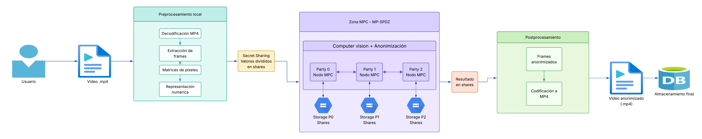

# T04 - Diseñar la arquitectura general del servidor seguro

> **Diagrama editable:** [Lucidchart - Arquitectura general del servidor seguro](https://lucid.app/lucidchart/283e3e0e-96fb-41aa-9be9-7402e8e1df15/edit?view_items=yU4rdh4xJzBn&page=0_0&invitationId=inv_dccfe362-a0e3-48cd-ac34-b44a0bbabe55)



## 1. Objetivo

El objetivo de esta arquitectura es definir el flujo general para recibir un video de videovigilancia, transformar su contenido a una representación que pueda ser utilizada por **MP-SPDZ**, procesarlo mediante **Multi-Party Computation (MPC)** y aplicar técnicas de **Computer Vision** para anonimizar información sensible, principalmente rostros y placas vehiculares.

La arquitectura busca que el video original no tenga que ser reconstruido dentro de los nodos de procesamiento. En su lugar, los valores numéricos que representan el contenido del video se dividen mediante **Secret Sharing** y se distribuyen entre distintas *parties* MPC. Estas parties colaboran para ejecutar el procesamiento seguro y únicamente se reconstruye el resultado autorizado, una vez que este ya ha sido anonimizado.

---

## 2. Flujo general

El flujo representado en el diagrama es el siguiente:

```text
Usuario
  ↓
Video .mp4
  ↓
Preprocesamiento local
  ↓
Secret Sharing
  ↓
Zona MPC - MP-SPDZ
  ↓
Resultado en shares
  ↓
Reconstrucción del resultado anonimizado
  ↓
Postprocesamiento
  ↓
Video anonimizado .mp4
  ↓
Almacenamiento final
```

Cada etapa tiene una responsabilidad específica y procura mantener separados el contenido original, los datos protegidos mediante shares y el resultado final anonimizado.

---

## 3. Usuario y video de entrada

El proceso inicia cuando el **usuario** selecciona un archivo de video en formato `.mp4`.

El video original se encuentra inicialmente en un entorno confiable del usuario. La intención es que las operaciones necesarias para preparar el video antes de entrar al entorno MPC se realicen localmente, evitando enviar el archivo original completo a un servidor central de procesamiento.

Esto es importante porque, si el video original se enviara primero a un servidor convencional, dicho servidor tendría acceso temporal al contenido sin anonimizar, lo cual reduciría el beneficio de utilizar MPC.

---

## 4. Preprocesamiento local

Antes de utilizar MP-SPDZ, el video debe transformarse a una representación numérica.

El bloque de **Preprocesamiento local** contiene cuatro etapas.

### 4.1. Decodificación del MP4

El archivo `.mp4` es un contenedor de video comprimido. MP-SPDZ no procesa directamente archivos de video, por lo que primero es necesario decodificar el contenido.

### 4.2. Extracción de frames

Una vez decodificado el video, este se divide en una secuencia ordenada de frames.

```text
video.mp4
   ↓
frame 1
frame 2
frame 3
...
frame n
```

Cada frame corresponde a una imagen individual dentro de la secuencia del video.

### 4.3. Matrices de píxeles

Cada frame se representa como una matriz de píxeles. En una imagen RGB, cada píxel contiene valores numéricos asociados a los canales rojo, verde y azul.

```text
Frame
  ↓
Matriz
  ↓
[ R, G, B ] [ R, G, B ] ...
[ R, G, B ] [ R, G, B ] ...
```

### 4.4. Representación numérica

Finalmente, los valores de las matrices se adaptan a los tipos numéricos que serán utilizados por el cálculo MPC.

Esta representación permite pasar de un archivo multimedia a datos sobre los cuales MP-SPDZ puede realizar operaciones matemáticas seguras.

---

## 5. Secret Sharing

Después del preprocesamiento se utiliza **Secret Sharing**.

El propósito de esta etapa no es dividir el video en fragmentos físicos, como ocurriría en el *sharding* tradicional de una base de datos. En MPC, cada valor secreto se transforma en varios valores llamados **shares**.

Por ejemplo, si un determinado valor de un píxel fuera:

```text
120
```

el sistema genera varios shares que, de manera conjunta, representan ese valor original:

```text
Valor original
     120
      ↓
 Secret Sharing
   /    |    \
share0 share1 share2
```

Cada share por separado no debe permitir recuperar el valor original. Posteriormente, cada share es enviado a una **party** diferente dentro de la zona MPC.

---

## 6. Zona MPC - MP-SPDZ

La parte central de la arquitectura corresponde a la **Zona MPC - MP-SPDZ**.

Para el prototipo se representa una arquitectura de tres participantes:

- **Party 0**
- **Party 1**
- **Party 2**

La cantidad de tres parties es una decisión arquitectónica del prototipo y no significa que MPC siempre requiera exactamente tres participantes. MP-SPDZ soporta diferentes configuraciones según el protocolo seleccionado y el modelo de amenaza.

Cada party representa un nodo independiente que ejecuta MP-SPDZ y participa en el cálculo seguro.

---

## 7. Comunicación entre parties

Las tres parties se comunican entre sí durante la ejecución del protocolo MPC:

```text
Party 0 ↔ Party 1 ↔ Party 2
```

Esta comunicación permite ejecutar operaciones que no pueden resolverse únicamente de manera local. Dependiendo del protocolo utilizado, operaciones como multiplicaciones, comparaciones, operaciones matriciales, convoluciones y condiciones pueden requerir intercambio de información entre las parties.

Lo importante es que este intercambio se realiza utilizando valores protegidos por el protocolo y no requiere que una party reconstruya por sí sola los valores originales del video.

---

## 8. Almacenamiento de shares

Cada party dispone de un almacenamiento asociado:

```text
Party 0 ↔ Storage P0
Party 1 ↔ Storage P1
Party 2 ↔ Storage P2
```

Estos almacenamientos contienen los **shares correspondientes a cada party**.

No almacenan una sección visible del video ni un conjunto específico de frames completos. Cada nodo mantiene solamente su representación compartida de los datos protegidos.

El almacenamiento puede utilizarse para mantener los shares requeridos durante las distintas etapas del procesamiento, siempre respetando el modelo de seguridad definido para el sistema.

---

## 9. Computer Vision y anonimización dentro del MPC

El bloque **Computer Vision + Anonimización** se encuentra dentro de la propia zona MPC porque el objetivo es que el procesamiento de la información sensible se realice sin reconstruir previamente el video original.

Las parties colaboran para ejecutar el mismo cálculo seguro:

```text
Party 0 ─┐
Party 1 ─┼──► Cálculo de Computer Vision mediante MPC
Party 2 ─┘
```

No existen tres modelos independientes que procesen tres partes distintas del video. Las parties participan conjuntamente en las operaciones necesarias para trabajar sobre los mismos datos protegidos.

El procesamiento de Computer Vision deberá realizar tareas como:

1. analizar los valores correspondientes a los frames;
2. detectar las regiones donde existen rostros o placas vehiculares;
3. aplicar el mecanismo de anonimización definido;
4. producir una nueva representación de los frames ya anonimizados.

Mientras se ejecuta este proceso, los datos permanecen representados como shares.

Por lo tanto, la arquitectura evita un flujo como:

```text
shares
  ↓
reconstrucción del video original
  ↓
Computer Vision convencional
```

El flujo deseado es:

```text
shares originales
      ↓
Computer Vision + anonimización mediante MPC
      ↓
shares del resultado anonimizado
```

---

## 10. Resultado en shares

Una vez finalizado el cálculo de Computer Vision, el resultado todavía se encuentra protegido mediante Secret Sharing.

Esto significa que las parties producen nuevos shares que representan los frames anonimizados:

```text
Party 0 → share resultado 0
Party 1 → share resultado 1
Party 2 → share resultado 2
```

Estos valores pueden reconstruirse de manera autorizada porque corresponden al **resultado anonimizado** y no al contenido original.

> En el diagrama, la reconstrucción está implícita entre el bloque **Resultado en shares** y el bloque **Postprocesamiento**. Antes de disponer de los frames anonimizados completos debe realizarse la reconstrucción autorizada del resultado generado por MPC.

---

## 11. Reconstrucción autorizada

La reconstrucción combina los shares del resultado para obtener nuevamente datos completos.

La diferencia fundamental es que esta reconstrucción ocurre **después de la anonimización**:

```text
Shares del resultado
        ↓
Reconstrucción autorizada
        ↓
Frames anonimizados
```

Por diseño, el sistema no pretende reconstruir el video original dentro de la infraestructura MPC. Únicamente se revela el resultado autorizado por el programa MPC.

---

## 12. Postprocesamiento

Una vez reconstruido el resultado anonimizado comienza la etapa de **Postprocesamiento**.

### 12.1. Frames anonimizados

El sistema obtiene nuevamente una secuencia ordenada de frames, pero en este punto las regiones sensibles ya han sido tratadas mediante el proceso de anonimización.

### 12.2. Codificación a MP4

Los frames anonimizados se vuelven a codificar para generar un archivo de video convencional:

```text
frames anonimizados
        ↓
codificación
        ↓
video_anonimizado.mp4
```

Esta etapa realiza el proceso inverso al preprocesamiento inicial desde el punto de vista del formato multimedia.

---

## 13. Video anonimizado

El producto principal del flujo es un archivo:

```text
video_anonimizado.mp4
```

Este archivo representa el resultado que puede entregarse al usuario o utilizarse posteriormente para otros objetivos del proyecto, como el análisis del tránsito.

A diferencia del video original, el resultado ya ha pasado por el proceso definido para ocultar la información sensible.

---

## 14. Almacenamiento final

El último componente representa el **almacenamiento persistente del resultado**.

En este almacenamiento se conserva el video anonimizado completo.

El icono de base de datos utilizado en el diagrama representa de forma lógica el almacenamiento final; la tecnología concreta puede definirse posteriormente y podría corresponder a almacenamiento de archivos, almacenamiento de objetos u otro mecanismo administrado por el servidor.

---

## 15. Diferencia entre Party, Share y Storage

Para evitar confusiones dentro de la arquitectura se utilizan tres conceptos distintos:

| Concepto | Función |
|---|---|
| **Share** | Valor matemático que representa una parte de un dato secreto. |
| **Party** | Nodo o participante MPC que recibe, mantiene y procesa shares. |
| **Storage** | Medio de almacenamiento asociado a una party para conservar sus shares. |

Por lo tanto:

```text
Share ≠ Party
Party ≠ Storage
```

Una representación sencilla sería:

```text
Dato original
     ↓
Secret Sharing
     ↓
┌─────────┬─────────┬─────────┐
│         │         │
▼         ▼         ▼
Share 0   Share 1   Share 2
│         │         │
▼         ▼         ▼
Party 0   Party 1   Party 2
│         │         │
↕         ↕         ↕
Storage   Storage   Storage
P0        P1        P2
```

---

## 16. Propiedad de seguridad principal

La decisión más importante del diseño es que el **video original no se reconstruye dentro de la zona MPC para ejecutar Computer Vision**.

El flujo protege los datos de la siguiente manera:

```text
Video original
      ↓
Procesamiento local
      ↓
Secret Sharing
      ↓
Shares distribuidos
      ↓
Cálculo MPC
      ↓
Computer Vision + anonimización
      ↓
Shares anonimizados
      ↓
Reconstrucción autorizada
      ↓
Video anonimizado
```

De esta manera, una party individual no necesita disponer del video original completo para participar en el cálculo.

---

## 17. Consideraciones del diseño

### 17.1. Número de parties

El diagrama utiliza tres parties como arquitectura propuesta para el prototipo. El número definitivo debe mantenerse alineado con el protocolo MPC que se seleccione posteriormente dentro de MP-SPDZ.

### 17.2. Modelo de amenaza

MP-SPDZ permite trabajar con diferentes protocolos y modelos de seguridad. La arquitectura general no fija todavía si el prototipo utilizará un modelo semi-honesto o malicioso, ni si el protocolo asumirá mayoría honesta o mayoría deshonesta.

Esta elección debe realizarse en función del nivel de seguridad requerido y del costo computacional aceptable.

### 17.3. Rendimiento

Procesar directamente matrices de píxeles mediante MPC puede implicar una carga considerable de CPU, memoria, tráfico de red, sincronización entre parties y tiempo de procesamiento.

Por esta razón, la arquitectura representa el flujo funcional deseado, mientras que la viabilidad y el rendimiento del procesamiento completo de Computer Vision deberán validarse mediante pruebas durante el desarrollo del prototipo.

### 17.4. Ubicación del preprocesamiento

El preprocesamiento se plantea del lado confiable antes del Secret Sharing. Esto reduce la necesidad de enviar el archivo `.mp4` original a un servidor central antes de protegerlo.

La implementación concreta puede realizarse en el navegador, en una aplicación cliente o en otro componente local confiable capaz de realizar la decodificación y generación de shares.
